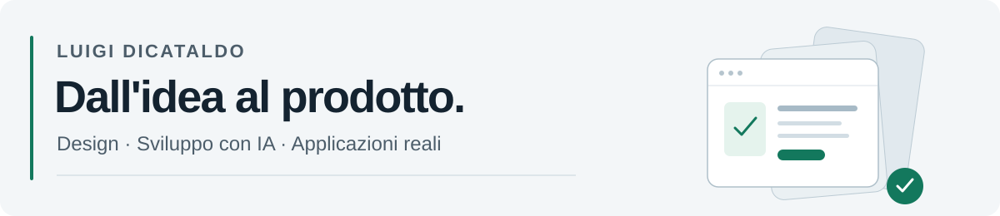

[English](README.md) · **Italiano**

<picture>
  <source media="(prefers-color-scheme: dark)" srcset="assets/profile-header-dark.svg">
  <source media="(prefers-color-scheme: light)" srcset="assets/profile-header-light.svg">
  
</picture>

**Software QA Tester · Automazione dei test · Sviluppo di applicazioni con IA**

Mi occupo di qualità del software in **EHILAB**, dove lavoro come QA Tester da gennaio 2024. Realizzo anche strumenti e applicazioni, seguendo il percorso dall'analisi dei requisiti al design UX/UI, all'implementazione, ai test e al rilascio.

Unisco l'attenzione alla qualità del software alla capacità di trasformare esigenze concrete in prodotti utilizzabili. Il mio percorso comprende la pubblicazione di un'app su **App Store** e la gestione degli aggiornamenti successivi.

[Confrontiamoci su LinkedIn](https://www.linkedin.com/in/luigi-dicataldo-0b3518249/)

## Cosa realizzo

| Ambito | Il mio contributo |
| --- | --- |
| **Strumenti di automazione dei test** | Ho ideato, progettato e sviluppato autonomamente da zero uno strumento che registra i test dal browser e genera automaticamente script Python. |
| **Flussi operativi** | Ho sviluppato un gestionale per semplificare il lavoro quotidiano e la gestione dei ticket, con automazioni e integrazione Jira. |
| **Applicazioni per esigenze reali** | Realizzo applicazioni mobile, desktop e web: requisiti, UX/UI, implementazione, test, distribuzione e miglioramenti successivi. |

## La qualità nel lavoro quotidiano

- Test manuali e di regressione, con gestione ed esecuzione dei casi di test in **TestRail**.
- Verifica delle API con **Postman** e analisi di richieste e risposte tramite **DevTools**.
- Segnalazione e tracciamento delle anomalie in **Jira**, collaborando con gli sviluppatori per approfondirle.
- Accesso a macchine virtuali, analisi dei log e supporto operativo di primo livello, anche notturno, per progetti che richiedono assistenza immediata.

## Dai requisiti al rilascio

| Fase | Come lavoro |
| --- | --- |
| **Comprendere il problema** | Definisco requisiti, flussi d'uso e criteri di accettazione a partire da un'esigenza concreta. |
| **Progettare l'esperienza** | Costruisco prototipi, schermate e interazioni, migliorando chiarezza e coerenza. |
| **Sviluppare e integrare** | Collego interfacce, logica applicativa, database e servizi esterni. |
| **Guidare lo sviluppo con IA** | Fornisco contesto e istruzioni strutturate, scompongo i problemi in attività circoscritte e rivedo e correggo le soluzioni prodotte. |
| **Verificare il risultato** | Controllo i flussi principali, gli errori e i casi limite rispetto al comportamento atteso. |
| **Rilasciare e migliorare** | Preparo la distribuzione e seguo correzioni, feedback e aggiornamenti del prodotto. |

Procedo per iterazioni brevi, prototipi e obiettivi espliciti, mantenendo collegati implementazione, design e verifica.

## Strumenti e tecnologie

**QA e collaborazione:** Postman · TestRail · DevTools · Jira · Git

**Formazione ed esperienza nello sviluppo:** Python · Java · C · SQL · HTML · CSS · Spring · MySQL

**Tecnologie utilizzate nei progetti personali:** TypeScript · React Native · Expo · Swift · SvelteKit · PostgreSQL · Docker

## Codice e riservatezza

I repository applicativi restano privati. Questo profilo presenta metodo, responsabilità e ambiti di lavoro senza divulgare nomi dei progetti, codice sorgente privato o dati aziendali.

---

[Versione inglese](README.md) · [LinkedIn](https://www.linkedin.com/in/luigi-dicataldo-0b3518249/)
