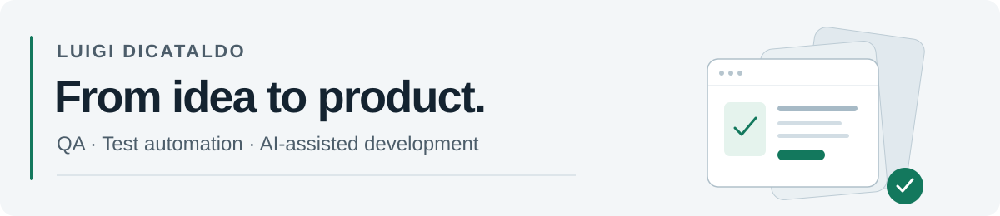

**English** · [Italiano](README.it.md)

<picture>
  <source media="(prefers-color-scheme: dark)" srcset="assets/profile-header-en-dark.svg">
  <source media="(prefers-color-scheme: light)" srcset="assets/profile-header-en-light.svg">
  
</picture>

**Software QA Tester · Test automation · AI-assisted application development**

I work in software quality at **EHILAB**, where I have been a QA Tester since January 2024. I also build tools and applications, taking them from requirements and UX/UI design through implementation, testing and release.

My work combines attention to software quality with the ability to turn real needs into usable products. My experience includes publishing an app on the **App Store** and managing subsequent updates.

[Connect on LinkedIn](https://www.linkedin.com/in/luigi-dicataldo-0b3518249/)

## What I build

| Area | My contribution |
| --- | --- |
| **Test automation tools** | Independently conceived, designed and built a tool from scratch that records browser tests and automatically generates Python scripts. |
| **Operational workflows** | Developed a management application to simplify daily work and ticket management, with automation and Jira integration. |
| **Applications for real use** | Build mobile, desktop and web applications, covering requirements, UX/UI, implementation, testing, distribution and ongoing improvements. |

## Quality in practice

- Manual and regression testing, with test cases managed and executed in **TestRail**.
- API testing with **Postman** and request/response analysis using **DevTools**.
- Defect reporting and tracking in **Jira**, working with developers to investigate issues.
- Virtual machine access, log analysis and first-line operational support, including night-time support for projects that require an immediate response.

## From requirements to release

| Stage | How I work |
| --- | --- |
| **Understand the problem** | Define requirements, user flows and acceptance criteria around a concrete need. |
| **Design the experience** | Develop prototypes, screens and interactions, refining clarity and consistency. |
| **Build and integrate** | Connect interfaces, application logic, databases and external services. |
| **Guide AI-assisted development** | Provide context and structured instructions, break problems into focused tasks, and review and debug the resulting solutions. |
| **Test the outcome** | Check core workflows, errors and edge cases against the expected behaviour. |
| **Release and improve** | Prepare distribution and follow up with fixes, feedback and product updates. |

I work in short iterations, using prototypes and explicit goals to keep implementation, design and verification connected.

## Tools and technologies

**QA and collaboration:** Postman · TestRail · DevTools · Jira · Git

**Development background:** Python · Java · C · SQL · HTML · CSS · Spring · MySQL

**Technologies used in personal projects:** TypeScript · React Native · Expo · Swift · SvelteKit · PostgreSQL · Docker

## Code and confidentiality

Application repositories remain private. This profile presents my methods, responsibilities and areas of work without disclosing project names, private source code or business data.

---

[Italian version](README.it.md) · [LinkedIn](https://www.linkedin.com/in/luigi-dicataldo-0b3518249/)
