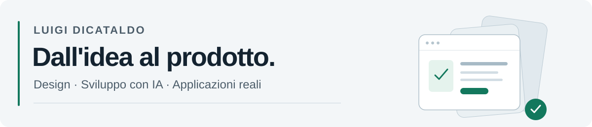

<picture>
  <source media="(prefers-color-scheme: dark)" srcset="assets/profile-header-dark.svg">
  <source media="(prefers-color-scheme: light)" srcset="assets/profile-header-light.svg">
  
</picture>

Trasformo idee ed esigenze concrete in applicazioni mobile, desktop e web, utilizzando in modo avanzato l'intelligenza artificiale nella progettazione e nello sviluppo.

Seguo il percorso completo del prodotto: analisi del bisogno, esperienza utente, design dell'interfaccia, implementazione, test e rilascio. Ho realizzato applicazioni per esigenze operative e quotidiane, con esperienza di pubblicazione su App Store.

## Dall'idea al prodotto

| Fase | Come lavoro |
| --- | --- |
| **Analisi e requisiti** | Traduco un problema in funzionalità, flussi d'uso e criteri di accettazione. |
| **UX e UI design** | Progetto schermate, navigazione e interazioni, curando semplicità d'uso e coerenza visiva. |
| **Architettura e integrazioni** | Collego interfacce, logica applicativa, database e servizi esterni in una soluzione completa. |
| **Sviluppo con l'IA** | Guido gli assistenti attraverso contesto, istruzioni strutturate e attività circoscritte, integrando e rivedendo le soluzioni prodotte. |
| **Test e affidabilità** | Verifico i flussi principali, affronto errori e casi limite e intervengo sulle criticità emerse. |
| **Rilascio ed evoluzione** | Preparo la distribuzione del prodotto e ne sviluppo i miglioramenti successivi. |

## Strategie di lavoro

Procedo per prototipi, obiettivi circoscritti e iterazioni brevi. Definisco il risultato atteso, verifico il comportamento dell'applicazione e uso il feedback per migliorare design e funzionalità.

L'IA è parte del mio processo di realizzazione: la guido nella scomposizione dei problemi, nell'implementazione e nel debugging, mantenendo il controllo sui requisiti e sul risultato finale.

## Applicazioni nella vita reale

I miei lavori riguardano la gestione di processi operativi, l'organizzazione personale e condivisa, la produttività e l'interazione tra dispositivi. Comprendono interfacce mobile e desktop, dati condivisi, aggiornamenti in tempo reale e funzionalità offline.

Il filo conduttore è costruire strumenti che rispondano a un'esigenza reale e siano semplici da usare nel contesto per cui sono stati progettati.

## Codice e riservatezza

Mantengo il codice applicativo in repository privati. Qui presento il mio metodo, le competenze applicate e gli ambiti dei lavori realizzati.
